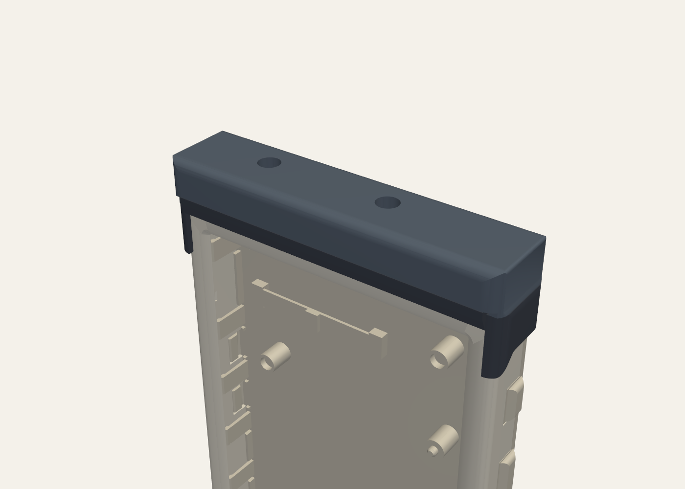

# Silkscreen audio attachment

> [!IMPORTANT]
> **AI-generated design. This is an accessory, not part of the Silkscreen PCBA.**
>
> This audio attachment was designed with substantial AI assistance: its board and housing are generated by code
> written with AI tools. The Silkscreen PCBA itself ([silkscreen-pcb](https://github.com/iandchasse/silkscreen-pcb))
> was not AI-generated. See Silkscreen's AI disclosure: https://silkscreenreader.com/ai

**A clip-on headphone / line output for the [Silkscreen](https://github.com/iandchasse/silkscreen-pcb) e-reader.**
It is a small cap that pushes onto the top of the 4.26" case, the same way as the
[light attachment](https://github.com/iandchasse/silkscreen-light-attachment). Six header pins go down through the opening the case already has
in its top wall and plug into the main board's expansion header, the 12-pin socket on its top edge (`J6`). The case
is not modified. A 3.5 mm stereo jack sits at the cap's left end, as seen from the display side.

> **Status (2026-11-09): rev A, designed and checked in CAD. NOT built or tested.**
> - **Board:** passes ERC 0 and DRC 0 with schematic parity, plus its own pin-position, keep-out, silk and field gates.
> - **Printed parts:** pass every scripted fit check against the current 4.26" standard case.
> - **First article:** see [docs/ASSEMBLY.md](docs/ASSEMBLY.md) "First power-up". Meter the jack's tip/ring/sleeve
>   mapping before plugging in headphones.



## How it works
- **Signals:**
  - The e-reader sends audio as I2S on the expansion header's three spare GPIOs: bit clock on `IO46` (pin 2), data on
    `IO45` (pin 3), word select on `IO3` (pin 9).
  - No master clock, no I2C, no setup registers.
- **Audio path:** a TI **PCM5102A** DAC drives a TI **TPA6138A2** ground-centred headphone driver, which drives the
  jack (tip = left, ring = right, sleeve = ground).
  - About 40 mW into 32 Ω.
  - About 2 Vrms into a line input.
- **Power:**
  - It comes from the battery pin (pin 12) through a TI **TPS7A2033** 3.3 V regulator.
  - The regulator only turns on while audio is playing: a two-diode charge pump on the word-select line drives its
    enable pin.
  - When the e-reader stops sending audio, the headphone driver mutes after about 1 s and the whole board switches off
    after about 2-4 s.
  - Idle draw is about 0.1 µA. The board never uses the header's 3V3 pin, which is limited to 20 mA on Rev 1.03.
- **Draw while playing:** about 33 mA in silence, about 50 mA at normal headphone level, about 110 mA at full volume
  into 32 Ω.
- **Presence detect:** the firmware can tell whether the cap is fitted.
  - It turns on `IO3`'s internal pull-up and reads the pin. The cap's 10 kΩ pull-down (`R7`) makes it read LOW.
  - With no cap, or with the light attachment (which has no pin 9), it reads HIGH.
- **Firmware:** the e-reader firmware needs I2S output added; it is not in the current firmware.
  - See [docs/FIRMWARE-NOTES.md](docs/FIRMWARE-NOTES.md) for the settings, the presence check and a tone-test example.
  - An existing CrossPoint fork already has an audio player (MP3, FLAC, AAC, Opus...) that can be ported with a few
    changes. [research/software.md](research/software.md) covers it, along with text-to-speech options and what the
    output should sound like: about phone-headphone-jack quality, against the 16 kHz "phone call" sound of some other
    e-readers.
- **Bluetooth:** not on the board.
  - The ESP32-S3 can't send Bluetooth headphone audio itself.
  - The one no-firmware module found is unverified, and JLC can't assemble it.
  - **A battery-powered 3.5 mm Bluetooth transmitter plugged into the jack works today.** See
    [docs/BLUETOOTH-FOLLOWUP.md](docs/BLUETOOTH-FOLLOWUP.md).

## What you need
| Item | Qty | Notes |
|---|---|---|
| Audio PCBA | 1 | 2 layers, 1.0 mm, 65.0 × 13.0 mm. JLCPCB assembles the 42 SMD parts on the top side. See [docs/ORDERING.md](docs/ORDERING.md) |
| Pin header 1 × 4, 11.5 mm (Hong Cheng HC-PZ254-11.5L-1x4PZ) | 1 | [LCSC C27985189](https://www.lcsc.com/product-detail/C27985189.html), soldered by you (`J1`, pins 1-4) |
| Pin header 1 × 1, 11.5 mm (Hong Cheng HC-PZ254-11.5L-1x1PZ) | 2 | [LCSC C27985186](https://www.lcsc.com/product-detail/C27985186.html), soldered by you (`J2` on pin 9, `J3` on pin 12) |
| Printed base and lid | 1 each | PETG (PLA for a trial), no supports. Base 20 min 21 s / 3.25 g; lid 12 min 36 s / 3.39 g (OrcaSlicer, 0.4 nozzle, 0.20 mm). Turn on "Detect thin wall" so the 0.2 mm stop under each screw hole prints |
| M2 × 3 pan-head screws | 2 | No longer than 3 mm |

Any standard 2.54 mm breakaway male header with 11.5 mm pins also works for the headers: 6.0 mm mating side, 2.5 mm
body and 3.0 mm tail. These are the same pins as the light attachment uses. Snap a 1 × 4 and two 1 × 1 pieces off a
strip.

**Cost:** about $41 for 5 assembled boards at JLCPCB (about $8 each), before shipping. Most of a small order is JLC's
fixed fees (about $25). See [docs/ORDERING.md](docs/ORDERING.md).

## Safety
- **Only these header pins have metal:** 1 and 4 (ground), 2, 3, 9 (I2S) and 12 (battery). The light pins (5, 6, 11),
  3V3 (7) and I2C (8, 10) have nothing on this board.
- **Plug it in only with the cap assembled.** The cap keys the pins: it only fits one way, and turned round the pins
  land on solid plastic. A bare board can be pushed in wrongly and would put the battery pin on the wrong pins.
- **All three audio lines are ESP32-S3 boot strapping pins.** `IO45` held HIGH at reset stops the e-reader booting;
  `IO46` HIGH breaks download mode; `IO3` only matters if a JTAG eFuse is burned.
  - The board only pulls them LOW, which is the correct level: 100 kΩ on `IO45`/`IO46` and 10 kΩ on `IO3`.
  - Nothing on it can drive a line HIGH.
  - Still, run the boot check in [docs/ASSEMBLY.md](docs/ASSEMBLY.md) on a first board.
- **While USB charges and audio plays,** the charger can't finish charging, because the board draws more than its
  termination current. Charging finishes normally a few seconds after the audio stops.
- **Volume:** the hardware has no volume control. Start the firmware at about -30 dBFS for headphones.

## Folders
| Path | What |
|---|---|
| `pcb/` | Generated KiCad 9 project (`pcb/tools/` builds everything; don't hand-edit the `.kicad_*` files). Fab files in `pcb/production/` |
| `housing/` | CadQuery project for the base and lid, its fit checks and print files (`housing/out/print/`) |
| `design/DESIGN-SPEC.md` | The design contract and the decisions behind it |
| `research/` | Audio chain, power, Bluetooth and software research (existing firmware, libraries, TTS, sound quality); `basis/` holds the J6 and case notes from the light attachment |
| `docs/` | Ordering, assembly, firmware notes, Bluetooth follow-up |

## Regenerating
**Board** (close KiCad first):
```
cd pcb
"C:\Program Files\KiCad\9.0\bin\python.exe" tools\generate.py --reroute
"C:\Program Files\KiCad\9.0\bin\python.exe" tools\make_outputs.py
```
- `generate.py` places the parts and routes the board; that takes about 10 min, up to 40 seeded attempts, stopping at
  the first with 0 failures.
- `make_outputs.py` writes production files only if every gate passes.

**Housing**, with the enclosure project's venv (CadQuery, trimesh, manifold3d):
```
cd housing\src
"..\..\..\silkscreen-enclosure-claude\.venv\Scripts\python.exe" build.py
```
- It reads `pcb/build/geometry.json`, the E-frame PCBA STL, and the case meshes in
  `../silkscreen-enclosures/enclosures/case-426/out/standard` (override with `SILKSCREEN_CASE_OUT`).
- The 3.68" case has no expansion header and isn't supported.

## Licence
CERN-OHL-S v2; see [LICENSE](LICENSE) and [NOTICE](NOTICE).
